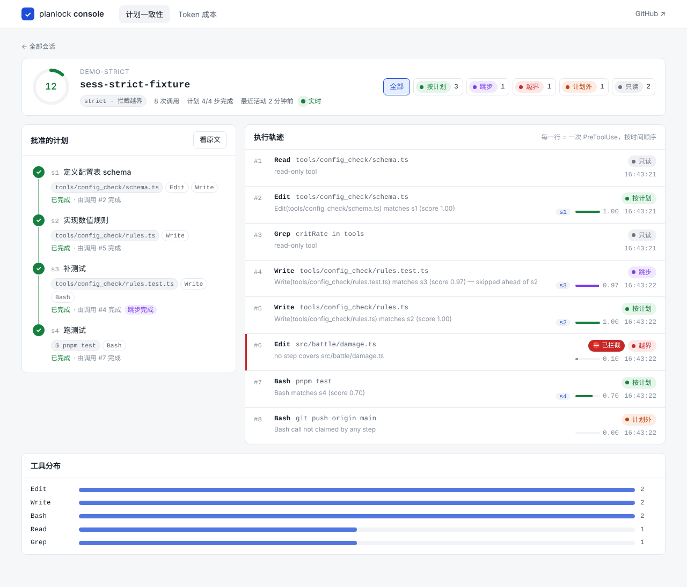

# planlock console

给 [planlock](https://github.com/Kac291/planlock) 和 [ClaudeThrottle](https://github.com/Kac291/ClaudeThrottle) 做的 Web 控制台：
**Agent 有没有按计划做事，每一轮花了多少钱**，在浏览器里实时看。

- **计划一致性**：回放 planlock 的 `events.jsonl`，把用户批准的计划画成步骤时间线，把每一次 `PreToolUse` 画成执行轨迹，标出按计划 / 部分命中 / 跳步 / 越界 / 计划外，strict 模式下被拦截的调用单独标红。通过 SSE 实时推送，Agent 每调一次工具页面就多一行。
- **Token 成本**：直接解析 Claude Code 的会话 transcript，按 message 去重后逐轮计价（输入 / 缓存写入 / 缓存读取 / 输出四段堆叠），并读取 ClaudeThrottle 的 `usage.log` 统计子 Agent 路由到 Haiku / Sonnet / Opus 的次数。

技术栈：**Vue 3 + TypeScript + Vite**（前端） · **Fastify + Node.js**（后端） · **Vitest**（测试）。图表是手写 SVG，没有引图表库。



## 快速开始

需要 Node.js ≥ 20。

```bash
npm install
npm run dev          # 前端 http://localhost:5173 ，API http://127.0.0.1:5174
```

打开就能看到仓库自带的两个演示会话（`fixtures/`，warn 模式和 strict 模式各一个）。这两份数据是用**真实的 planlock CLI** 跑出来的，不是手写的 JSON。

### 实时演示

```bash
# 先把 planlock 克隆到本仓库旁边并构建：../planlock/dist/cli.js
npm run demo                       # 每 1.5 秒模拟一次工具调用
npm run demo -- --mode strict      # 看越界调用被拦截
npm run demo -- --delay 400        # 快一点
```

`scripts/demo-live.mjs` 会建一个沙盒项目、`planlock init`、批准一份计划，然后按脚本把 Claude Code 的 hook payload 依次喂给 planlock 的 `capture-plan` / `match-tool`。控制台这边什么都不用做，打开会话页就能看到调用一条条进来。

### 接入自己的项目

在任何 `planlock init` 过的项目里正常用 Claude Code，然后把项目路径告诉控制台：

```bash
cp console.config.example.json console.config.json   # 填 projects 列表
# 或者用环境变量（Windows 用 ; 分隔，macOS/Linux 用 : 分隔）
PLANLOCK_PROJECTS="/path/to/project-a:/path/to/project-b" npm run dev
```

成本页默认读 `~/.claude/projects`（transcript）和 `~/.claude/throttle`（ClaudeThrottle），可用 `CLAUDE_PROJECTS_DIR`、`CLAUDE_THROTTLE_DIR` 覆盖。

生产模式：`npm run build && npm start`，由 Fastify 同时提供 API 和静态页面，只开 5174 一个端口。

## 设计取舍

**控制台不保存任何状态，每次都从日志回放。** planlock 本身就是这么做的：hook 每次是独立进程，步骤状态从 `events.jsonl` 回放出来。控制台沿用同一个原则：后端收到文件变化，就把整条日志重放成快照推给前端；前端只做 diff 决定哪几行要高亮。好处是界面上的状态和审计日志永远一致，刷新、断线重连、多个标签页同时开都不会对不上。

**判定逻辑和 planlock 对齐，并用测试锁住。** 计划从哪来（会话自己的 `plan-parsed` 事件，找不到再退回磁盘上最新的计划）、drift score 公式、observe / warn / strict 三档的提醒和拦截规则，都和 planlock 的 `report.ts` / `policy.ts` 一致。`tests/analyze.test.ts` 会直接读 fixture，断言控制台算出的结果和 planlock 自己生成的 `report.md` 相同（drift score 12、s3 跳步完成、1 次越界）。

**用 SSE，不用 WebSocket。** 数据只从服务端流向浏览器，SSE 足够，断线后浏览器会自动重连。文件监听用 `fs.watchFile` 轮询 stat，Windows、macOS、Linux 上行为一致，文件还没创建时也能监听。

**安全。** session id 和 plan id 都按 planlock 的规则校验（`[A-Za-z0-9._-]`），只能读取已配置项目下的 `.planlock/`，路径穿越会直接返回 404。服务只监听 `127.0.0.1`。

**成本口径。** transcript 里一个 assistant message 会拆成多行（每个 content block 一行），usage 相同，所以按 `message.id` 去重。缓存写入按输入价的 1.25 倍计，缓存读取按 0.1 倍计。单价取 ClaudeThrottle 的 `config/models.json`，所以这里的数字是**估算**，以 Anthropic 账单为准。

## 目录

```
server/
  analyze.ts   纯函数：配对 tool-call/drift、步骤状态、drift score、策略（无 IO，便于测试）
  store.ts     读取 .planlock/：会话列表、计划解析、会话快照
  cost.ts      transcript 逐轮计价、usage.log 路由统计
  index.ts     Fastify 路由 + SSE
web/src/
  views/       SessionsView · SessionView · CostView
  components/  StepList · CallFeed · CostChart · DriftGauge · VerdictPill
scripts/
  demo-live.mjs   驱动真实 planlock CLI 的演示脚本
fixtures/         两个由 planlock 生成的演示项目
tests/            Vitest
```

## API

| 方法 | 路径 | 说明 |
|---|---|---|
| GET | `/api/projects` | 所有项目及会话摘要 |
| GET | `/api/projects/:pid/sessions/:sid` | 会话快照：计划步骤、执行轨迹、计数、drift score |
| GET | `/api/projects/:pid/sessions/:sid/stream` | SSE，日志每次变化推送一个 `snapshot` 事件 |
| GET | `/api/cost` | 最近的 Claude Code 会话 + ClaudeThrottle 总路由 |
| GET | `/api/cost/:sid` | 某会话逐轮成本 |

## 开发

```bash
npm test             # Vitest
npm run typecheck    # vue-tsc + tsc
npm run fixtures     # 用 planlock 重新生成 fixtures/
```

## License

MIT
